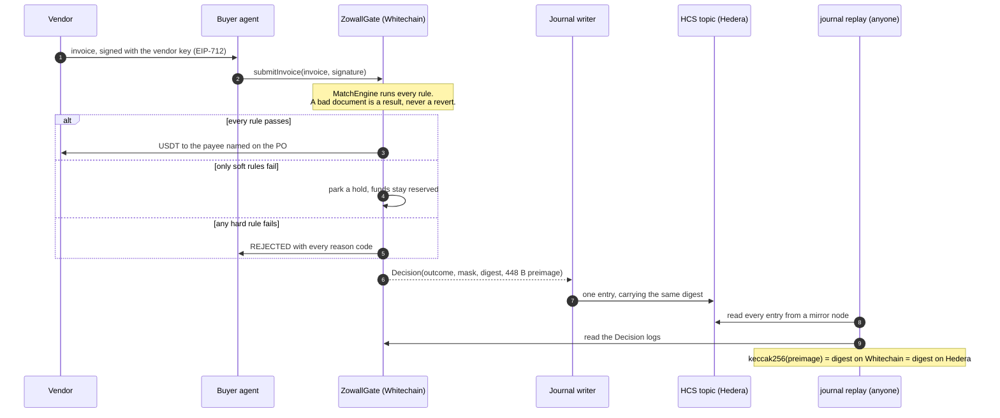
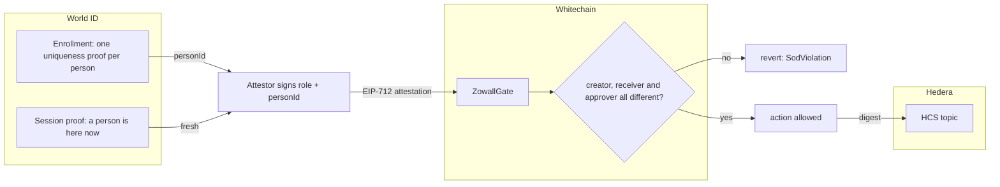
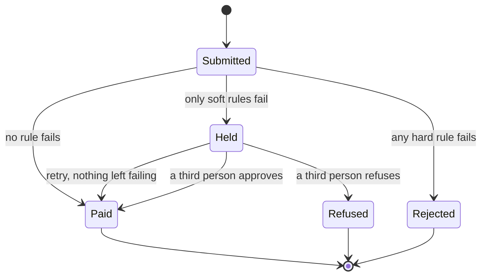
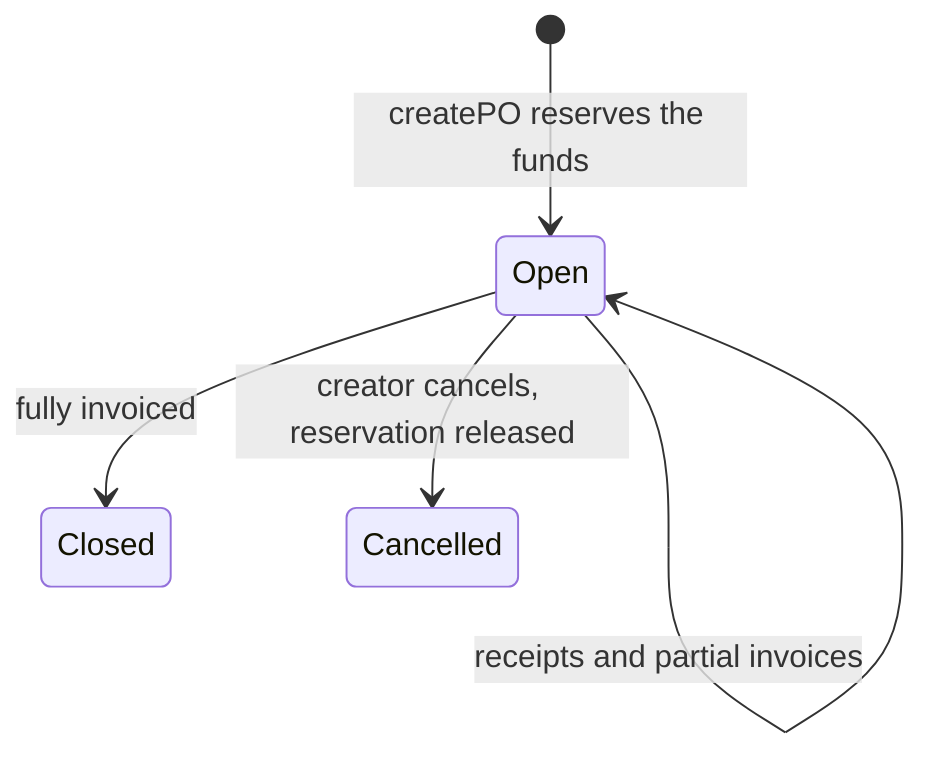
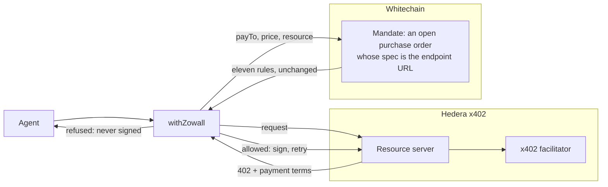

<p align="center">
  
</p>

<h1 align="center">Zowall</h1>

<p align="center">
  <strong>No PO, no pay.</strong><br>
  USDT on Whitechain, refusals on Hedera HCS.
</p>

## What it is

Zowall is a three-way invoice match for AI agents that hold a wallet. A purchase
order, a goods receipt and an invoice have to agree before money moves, and the
three people involved have to be three different humans.

The language model never decides whether money moves. It parses documents and
proposes. A deterministic contract disposes, and every decision is written
somewhere the buyer cannot edit it.

It runs as a drop-in SDK for agents that pay vendors, and as a middleware that
wraps an agent's x402 payments so a machine payment faces the same checks.

## Proof it runs

| | |
|---|---|
| Network | Whitechain Sepolia (chain id **1874**) |
| `ZowallGate` | [`0x1fcb96e5e1a092bab2376517036113beb3cc9c5a`](https://explorer.testnet.whitechain.io/address/0x1fcb96e5e1a092bab2376517036113beb3cc9c5a) — source verified |
| Hedera journal topic | [`0.0.11335431`](https://hashscan.io/testnet/topic/0.0.11335431) — submit key, no admin key |
| USDT (6 dp) | [`0xcedfB56113143d55b2358b8CFbB0dEB5Ad2f55a7`](https://explorer.testnet.whitechain.io/address/0xcedfB56113143d55b2358b8CFbB0dEB5Ad2f55a7) |
| Attestor | `0xdCa82154FA9f7a95277729e9a6861f4E023ab997` |

A real USDT payment settled through the main flow, and three refusals, each a
transaction anyone can open:

| Outcome | Transaction |
|---|---|
| **PAID** 2.00 USDT | [`0xa22aa4ec…`](https://explorer.testnet.whitechain.io/tx/0xa22aa4ec943d977d3b7d78b246f4266663f18abd374616168c3a37ec690a3b4a) |
| `REJECTED NO_PO` | [`0xc9b2fa41…`](https://explorer.testnet.whitechain.io/tx/0xc9b2fa4135a086eb90936fedb722c96e8a69c6a8998785a29e416496f7105c6e) |
| `REJECTED PAYEE_MISMATCH` | [`0x983cbcc0…`](https://explorer.testnet.whitechain.io/tx/0x983cbcc0ea16e7cf58ab243e7584957a9d2b13e0dc39ccecb092ab7530deda68) |
| `REJECTED DUPLICATE_INVOICE` | [`0xedad25c3…`](https://explorer.testnet.whitechain.io/tx/0xedad25c31250805384ebdac02a15f42f4f9a2aa64719d0139a1944ec210c358b) |

An x402 spend mandate is an order on the same gate, raised by one verified person
and signed for by another:

| Mandate (order #10) | Transaction |
|---|---|
| Order raised | [`0x004a2030…`](https://explorer.testnet.whitechain.io/tx/0x004a2030c8e2368bd37c8f27a7bd425ab7a9cfebdcb49d4f365ad675754489d8) |
| 20 calls signed for | [`0x04a1ec2d…`](https://explorer.testnet.whitechain.io/tx/0x04a1ec2d05a4453ff6238459fe27804ba0246883302a65e51ee824b3cd133661) |

Every decision is on the Hedera topic, and the replay recomputes each digest from
the chain's own logs:

```
$ node packages/journal/src/cli.ts replay 0.0.11335431 --gate 0x1fcb96e5e1a092bab2376517036113beb3cc9c5a

  OK    #17  REJECTED po#0 NO_PO · digest recomputed and matched
  OK    #18  REJECTED po#7 PAYEE_MISMATCH · digest recomputed and matched
  OK    #19  PAID po#7 clean · digest recomputed and matched
  OK    #20  REJECTED po#7 DUPLICATE_INVOICE · digest recomputed and matched

OK - journal and chain agree
```

Verify any single decision from its log alone, with nothing supplied by us:

```bash
node packages/e2e/src/verify-decision.ts 0xa22aa4ec943d977d3b7d78b246f4266663f18abd374616168c3a37ec690a3b4a
```

Reproduce the four outcomes:

```bash
set -a; source .env.local; set +a
node packages/e2e/src/flow.ts --refund --cleanup
```

In the running app, `/app/proofs` shows the same items read live: the topic's
keys from the public mirror node, the verified people, and the code paths behind
each.

## Sponsor integrations

| Sponsor | What is used | Where | Verify |
|---|---|---|---|
|  | A real USDT vault. Orders encumber a balance, a matched invoice pays from it in one transaction. | [`ZowallGate.sol`](packages/contracts/src/ZowallGate.sol), [`MatchEngine.sol`](packages/contracts/src/MatchEngine.sol) | [Gate on the explorer](https://explorer.testnet.whitechain.io/address/0x1fcb96e5e1a092bab2376517036113beb3cc9c5a), [a PAID transaction](https://explorer.testnet.whitechain.io/tx/0xa22aa4ec943d977d3b7d78b246f4266663f18abd374616168c3a37ec690a3b4a) |
|  | An HCS topic as the audit journal, a mirror-node replay, and a middleware around x402. | [`hcs.ts`](packages/journal/src/hcs.ts), [`replay.ts`](packages/journal/src/replay.ts), [`x402/`](packages/x402/src) | [Topic on HashScan](https://hashscan.io/testnet/topic/0.0.11335431), `journal replay` |
|  | A uniqueness proof per person, validated on the server, compared on-chain. | [`verify/route.ts`](apps/web/app/api/world/verify/route.ts), [`verify.ts`](packages/world/src/verify.ts), [`ZowallGate.sol`](packages/contracts/src/ZowallGate.sol) | `/enroll`, `/app/proofs`, the `SodViolation` reverts |

Details, with file and line ranges, are in each sponsor's section below:
[Whitechain](#whitechain), [Hedera](#hedera), [World](#world).

## Why existing controls miss it

An agent with a wallet pays whatever its context tells it to. Every existing
control checks one dimension: a spend cap checks the amount, an allowlist checks
the counterparty, a reputation screen checks history, an approval group checks
who signed. None of them check whether the thing was ever ordered and received.

That check has a name in every ERP on earth: the three-way match. Auditors test
for it. Agents do not have one.

## Architecture


A PNG export is beside it at [`docs/architecture.png`](docs/architecture.png).
The orange path is the one an invoice travels: the vendor signs, the agent calls
`gate.pay`, the gate decides and emits a `Decision`, the journal writer carries
its digest to Hedera, and anyone can replay the two against each other.

The marks in the diagram are the originals from `apps/web/public/brands`, inlined
so the file renders anywhere. See [`SOURCES.md`](apps/web/public/brands/SOURCES.md).

### One decision, end to end

What happens between an agent asking to pay and anyone being able to check the answer.



### Who has to be a different person

World ID supplies the identities. The contract enforces that they differ.



### Life of an invoice

Hard rules refuse. Soft rules park the invoice for a different human.



### Life of a purchase order

The reservation is the point: it exists from the first state.



### The x402 middleware

A 402 response names a payee, a price and a thing being sold, and asks to be
paid. That is an invoice, so the same engine judges it.



## How it works

### The rules

Eleven reason codes, evaluated in a fixed order, **all** failures returned.
Eight are hard and reject outright; three are soft and park the invoice for a
different human.

| Code | Severity | Check |
|---|---|---|
| `NO_PO` | hard | no existing, open purchase order |
| `BAD_SIGNATURE` | hard | signer is not the PO's vendor key, or the payload expired |
| `PAYEE_MISMATCH` | hard | invoice payee is not the PO payee |
| `PO_EXPIRED` | hard | invoice arrived after expiry |
| `PO_CLOSED` | hard | closed, or fully invoiced |
| `DUPLICATE_INVOICE` | hard | this invoice hash was decided before |
| `BUDGET_EXCEEDED` | hard | no reservation left for this quantity at the agreed price |
| `SOD_VIOLATION` | hard | one human holds two roles on one PO |
| `NO_RECEIPT` | soft | nothing recorded as received yet |
| `QTY_OVER_RECEIVED` | soft | invoiced more than arrived |
| `PRICE_OVER_TOLERANCE` | soft | unit price above the agreed price plus tolerance |

Three design rules that are easy to get wrong:

**One fact, one code; the most specific wins.** `NO_RECEIPT` suppresses
`QTY_OVER_RECEIVED`. `QTY_OVER_RECEIVED` suppresses `BUDGET_EXCEEDED` - a
quantity variance is something a human can review, and hard-rejecting it would
mean the exception queue never sees the case it exists for.

**The reservation covers the tolerance ceiling, not the headline total.** A 5%
tolerance means an invoice at 42 against a PO at 40 is legitimate, so reserving
only 40 would refuse to settle an invoice the rules just approved.

**An override is a purchase order amendment.** When a third human accepts a
variance that costs more than was reserved, the shortfall is drawn from
*unencumbered* balance and recorded in the event. It can never come out of
another purchase order's reservation.

### Segregation of duties

The creator, the receiver and the approver must be three different humans, and
that is enforced on-chain against World ID enrolment nullifiers.

A nullifier is scoped to RP + action and issued once per human per action, so
per-event proofs cannot be compared across roles. Identity therefore comes from
a single enrolment action, and freshness comes from repeatable session proofs.
[`packages/world/README.md`](packages/world/README.md) has the full reasoning.

### Why there are two chains

**Whitechain** holds the money. A purchase order reserves (encumbers) its total
against a real USDT balance, so a vendor can verify on-chain that funds are set
aside against their order *before they ship* - without being given access to the
buyer's books. A matched invoice settles in about a second instead of net-60.

**Hedera** holds the record. The buyer must not be able to rewrite the log of
its own refusals. The journal topic has a submit key, so only this service can
append, and no admin key, so it is immutable and undeletable. Anyone can read it
from a public mirror node and run the replay without asking us.

The two are bound by a content digest that `gate-core` computes and both sides
carry. The `Decision` event carries the **448-byte preimage** the digest is taken
over, not just the digest. That is what makes "replay our refusals without asking
us" true rather than nearly true: without it the digest would cover quantities,
prices, person ids and a nonce that the log does not contain. With it,
`keccak256(preimage)` is the digest and the digest is what the journal carries.

## Whitechain


**A stablecoin that reserves before it pays.**

| What is used | Where |
|---|---|
| `ZowallGate.sol` on chain 1874, source verified on the Whitechain explorer | [`ZowallGate.sol`](packages/contracts/src/ZowallGate.sol) |
| The Whitechain Sepolia USDT, 6 decimals, as the vault asset. No stand-in token. | [`createPO` L218](packages/contracts/src/ZowallGate.sol#L218) |
| A matching invoice settles in one transaction | [`submitInvoice` L318](packages/contracts/src/ZowallGate.sol#L318) |
| A third person releases a hold | [`resolveHold` L363](packages/contracts/src/ZowallGate.sol#L363) |
| An override draws from free balance only | [`_amend` L548](packages/contracts/src/ZowallGate.sol#L548) |
| The creator can cancel and release the reservation | [`cancelPO` L268](packages/contracts/src/ZowallGate.sol#L268) |
| The rules, mirrored from the TypeScript engine | [`MatchEngine.sol`](packages/contracts/src/MatchEngine.sol), [`evaluate` L14](packages/gate-core/src/evaluate.ts#L14) |

**What is new about it.** Payment controls usually sit in front of a transfer.
Here the stablecoin balance is also the ledger of what has been promised: a
purchase order encumbers its total before anything ships, so a vendor can check
on-chain that the money is set aside without being given access to the buyer's
books. The reservation is accounting over a real balance, and an override can
never spend another order's reservation.

**Why it holds up.**

- 28 Foundry tests mirror the acceptance suite, and the same scenarios run
  against the TypeScript engine so the two cannot disagree.
- A bad document comes back as `REJECTED` or `HELD` with every failing reason. It
  never reverts, so the reason survives.
- No withdraw function. A vault the operator can empty is not a reservation.
- Attestations are single use, expire, and are domain-bound to this contract.
- Each `Decision` event carries its own 448-byte preimage, so a log verifies
  itself.

## Hedera


**An audit journal the buyer cannot rewrite, and a middleware around x402.**

| What is used | Where |
|---|---|
| An HCS topic with a submit key held by the service and no admin key | [`createTopic` L91](packages/journal/src/hcs.ts#L91), [`setSubmitKey` L111](packages/journal/src/hcs.ts#L111) |
| One decision per message, never more than 1024 bytes, never chunked | [`entry.ts`](packages/journal/src/entry.ts) |
| A writer that never blocks a payment: a failed write queues and retries | [`JournalWriter` L124](packages/journal/src/hcs.ts#L124), [`QueueingWriter` L189](packages/journal/src/hcs.ts#L189) |
| Key handling that picks the curve from the key's shape | [`parseKey` L57](packages/journal/src/hcs.ts#L57) |
| Public mirror-node reads, no credentials | [`readTopic` L45](packages/journal/src/mirror.ts#L45) |
| The replay: recompute every digest from Whitechain's logs and compare | [`replay` L94](packages/journal/src/replay.ts#L94), [`digest_mismatch` L198](packages/journal/src/replay.ts#L198) |
| The digest both chains carry | [`encodeDecision` L59](packages/gate-core/src/canonical.ts#L59), [`journalDigest` L81](packages/gate-core/src/canonical.ts#L81) |
| A metered endpoint that answers HTTP 402 with payment terms | [`x402/match/route.ts` L33](apps/web/app/api/x402/match/route.ts#L33) |
| A middleware that wraps an agent's x402 payments | [`withZowall` L72](packages/x402/src/middleware.ts#L72), [`createGuard` L68](packages/x402/src/guard.ts#L68) |
| A 402 quote mapped onto an invoice | [`quoteToInvoice` L111](packages/x402/src/quote.ts#L111), [`resourceSpecHash` L38](packages/x402/src/quote.ts#L38) |

**What is new about it.** HCS is used as a witness for a different chain. Each
journal entry carries the digest of a Whitechain decision, and anyone can
recompute that digest from Whitechain's own logs, so the two records cannot drift
apart without the replay saying so. The buyer cannot soften a refusal after the
fact, and an auditor does not need our database.

**The middleware.** x402 answers how a machine pays. It is silent on whether this
machine should be paying this, to this address, at this price, again.
[`@zowall/x402`](packages/x402/README.md) wraps the agent's `fetch` and matches
every 402 against a mandate a person signed, before the wallet is asked to sign.
A mandate is an open order on Whitechain whose spec is the endpoint URL, not a
config file. Anything that is not a 402 passes straight through.

| What the quote does | Code |
|---|---|
| Names an endpoint nobody authorised | `NO_PO` |
| Asks to be paid somewhere else | `PAYEE_MISMATCH` |
| Raises the price after the mandate was signed | `PRICE_OVER_TOLERANCE` |
| Is a quote already decided | `DUPLICATE_INVOICE` |
| Spends past the authorised call count | `QTY_OVER_RECEIVED` |

In the running app, `/app/metered` runs each of these against a live 402. A
refused quote never reaches the wallet. The 402 resource it calls is a local
stand-in that speaks the protocol and settles nothing; its settlement is marked
simulated.

**Why it holds up.**

- The replay recomputes every digest with the engine the contract mirrors.
- Ten replay tests, among them: an edited digest, a softened outcome, a dropped reason code and
  restated quantities are each caught.
- Junk that a stranger submits to the topic is skipped, not fatal.
- The journal never blocks a payment.
- 19 middleware tests, most of them attacks: an unauthorised endpoint, a payee
  swapped at quote time, a price raised after the fact, a replay, an exhausted
  allowance.

## World


**Proof of distinct humans, not just a human.**

| What is used | Where |
|---|---|
| An IDKit v4 uniqueness proof under one enrolment action; the nullifier is each person's stable `personId` | [`EnrollCard.tsx`](apps/web/components/product/EnrollCard.tsx), [`use-world-enroll.ts`](apps/web/lib/use-world-enroll.ts) |
| Proofs verified on the server against World's v4 endpoint, forwarded as received | [`verifyWorldProof` L42](packages/world/src/verify.ts#L42), [`verify/route.ts` L15](apps/web/app/api/world/verify/route.ts#L15) |
| A request context signed on the server, with a single-use nonce | [`api/world/config`](apps/web/app/api/world/config/route.ts) |
| The enrolment registry, persisted across restarts | [`JsonFileEnrollmentStore` L124](packages/world/src/registry.ts#L124) |
| EIP-712 role attestations, signed only after verification | [`signAttestation` L64](packages/world/src/attest.ts#L64) |
| Attestations checked on-chain with `ecrecover` | [`SigLib.sol`](packages/contracts/src/SigLib.sol) |
| The refusal: one person holding two roles reverts | [`SodViolation` L190](packages/contracts/src/ZowallGate.sol#L190), [L295](packages/contracts/src/ZowallGate.sol#L295), [L372](packages/contracts/src/ZowallGate.sol#L372) |

**What is new about it.** A World ID nullifier is scoped to one action, so proofs
from different actions cannot be compared. Zowall separates identity from
freshness: one enrolment action yields a stable `personId`, and segregation of
duties compares those ids. That lets a contract say that three approvals came from
three different people, which a plain proof of personhood cannot. The credential
asked for is uniqueness only, the minimum that supports "a different person
approved this".

**Why it holds up.**

- The denied path happens on-chain: the person who raised an order and the person
  who signed for the delivery each try to release a hold, both transactions revert
  with `SodViolation`, and the hold stays open.
- Attestations are single use, expire after ten minutes, and name the role and the
  order.
- `nullifier_replayed` is handled as World recognising a person, not as a failed
  integration.
- Fifteen tests cover the registry, role codes, freshness modes and verification.

## Try it

```bash
pnpm install
cp .env.example .env.local     # fill it in; see docs/SETUP.md
pnpm dev
```

The workspace is the product; the explainer is a guided tour of it.

| Page | What it is |
|---|---|
| `/` | The landing page |
| `/app` | Workspace overview: vault, decisions, exceptions, people |
| `/app/start` | Setup in four tabs: people, vault, agent, rules |
| `/app/orders`, `/app/exceptions` | Purchase orders, and the queue a third person works |
| `/app/agents`, `/app/metered` | The agent call log, and the x402 middleware against a live 402 |
| `/app/proofs` | Every claim above, read live, with the code behind it |
| `/enroll` | Verify a person with World ID |
| `/walkthrough` | Eleven steps against the real gate |
| `/attack` | Type anything a finance team might receive; a gullible agent acts on it |
| `/journal` | The Hedera journal read from a public mirror node |
| `/vendor/[poId]` | What the vendor sees: what is reserved for them and where their invoice stands |

Every page reads the chain and the Hedera topic directly. There is no database.

## Layout

```
packages/
  gate-core/     the match engine. pure, no chain, no network, no dependencies
  contracts/     ZowallGate.sol + MatchEngine.sol (Foundry)
  journal/       Hedera HCS writer, mirror reader, replay CLI
  world/         World ID enrolment, freshness, EIP-712 attestations
  sdk/           the drop-in: gate.pay(invoice, sig)
  x402/          middleware that gates an agent's x402 payments
  agent/         a deliberately gullible buyer agent
  e2e/           live runner and single-decision verifier
apps/
  web/           Next.js 16: workspace, explainer, vendor portal, API
docs/
  architecture.svg   the hero diagram, logos inlined
  SETUP.md           credentials and configuration
```

Each package has its own README explaining the decisions inside it.
[`packages/gate-core/README.md`](packages/gate-core/README.md) is the one to read first.

## Running it

Needs Node 24+, pnpm 10+ and Foundry.

```bash
pnpm install
cp .env.example .env.local     # nothing has a working default

pnpm test                      # every package
pnpm test:contracts            # forge, 28 scenarios
pnpm dev                       # the web app
```

| Suite | Tests |
|---|---|
| `gate-core` | 45 |
| `contracts` (Foundry) | 28 |
| `x402` | 19 |
| `world` | 15 |
| `journal` | 10 |
| `sdk` | 4 |

## What's next

- Settle a paid x402 request end to end through a facilitator, instead of the
  local stand-in.
- Write middleware decisions to the Hedera journal under their own entry kind.
- Session proofs for per-action freshness.
- Bind a receiver to each order at creation.

## License

MIT. See [`LICENSE`](LICENSE).
