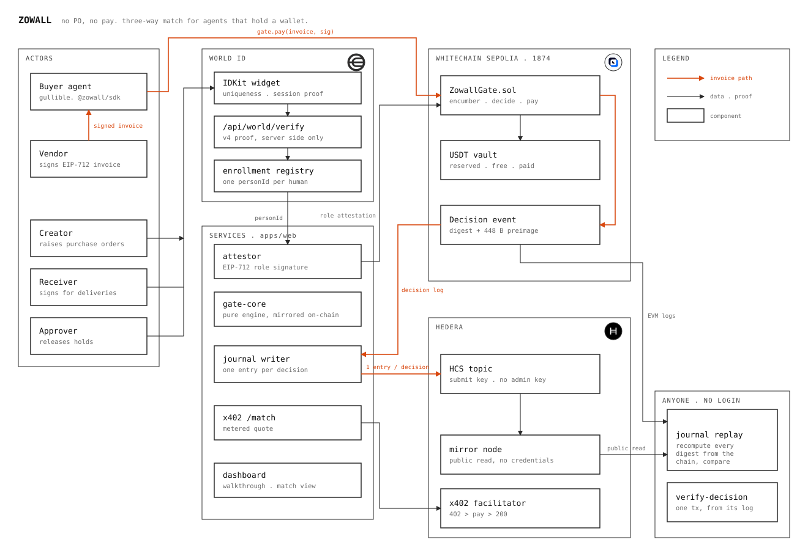
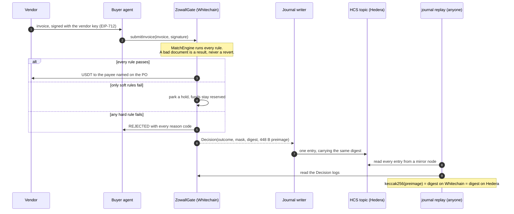
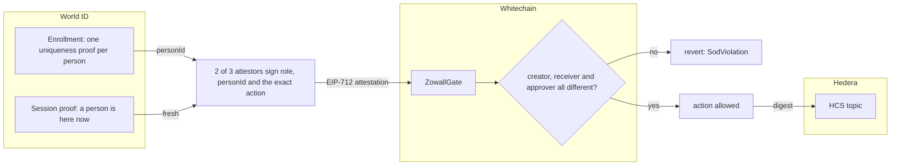
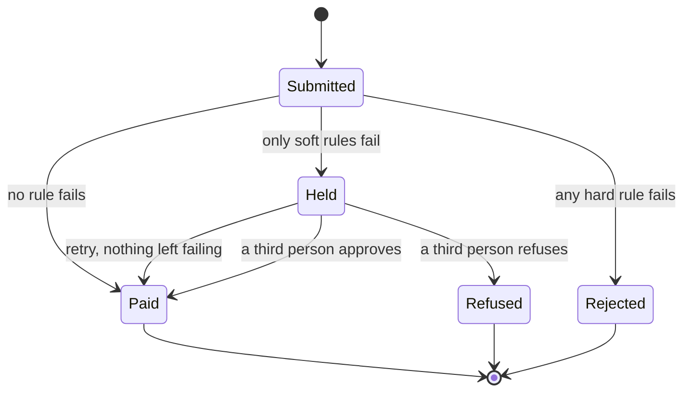
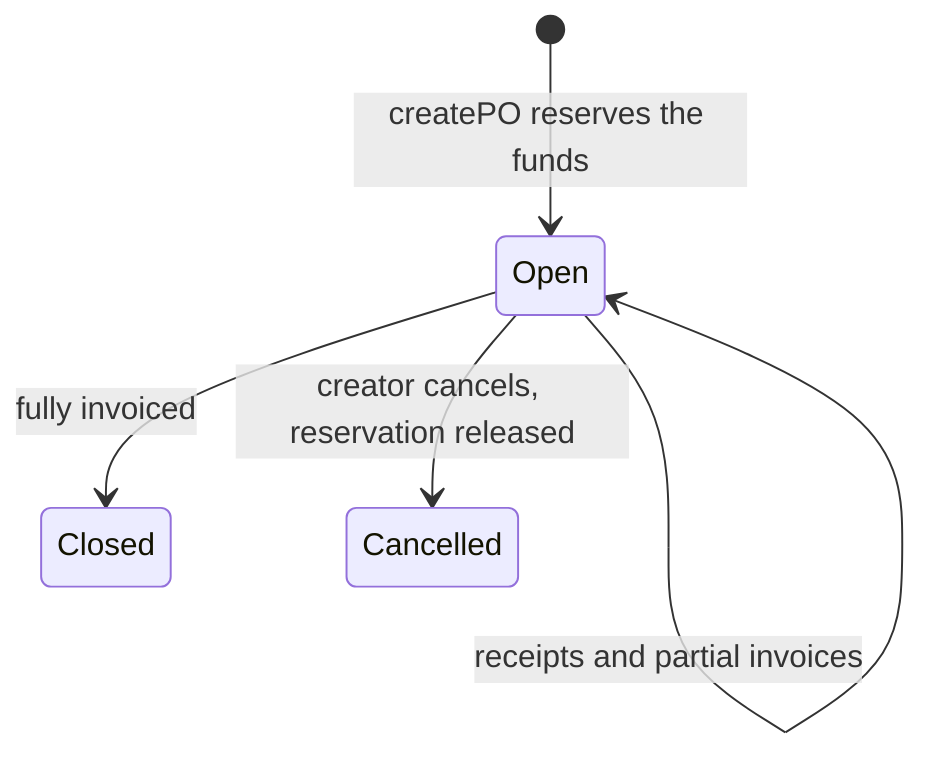
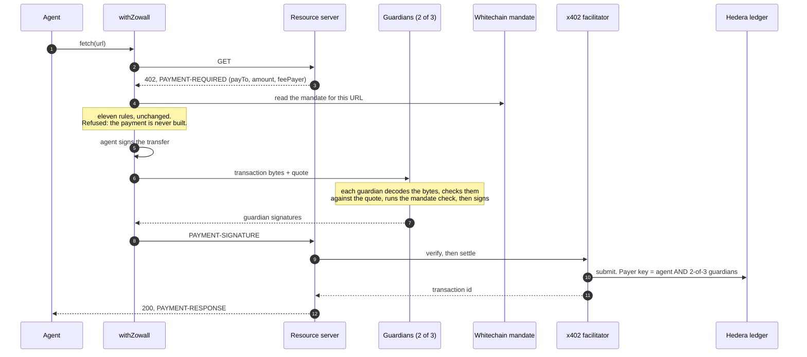
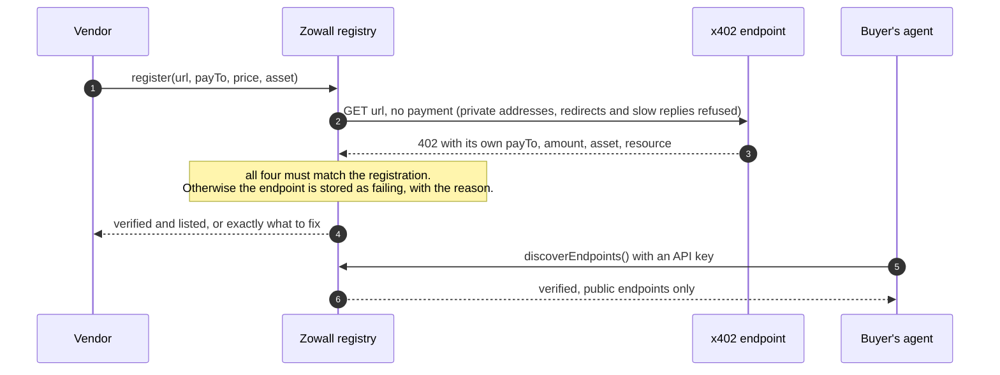
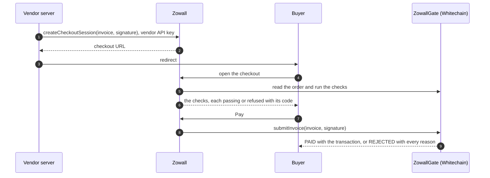

<p align="center">
  
</p>

<h1 align="center">Zowall</h1>

<p align="center">
  <strong>Agents never get scammed.</strong><br>
  Institutional paywall for x402, using HCS and World ID on Whitechain.
</p>

## What it is

Zowall is a payments platform for x402 endpoints and the agents that pay them,
the way Stripe and Razorpay are for cards. Vendors register the paid endpoints
they sell and are verified before they are listed. Buyers get an API key,
discover what they can pay for, and pay through a guard. Under it is a
three-way invoice match: a purchase order, a goods receipt and an invoice have
to agree before money moves, and the three people involved have to be three
different humans.

The language model never decides whether money moves. It parses documents and
proposes. A deterministic contract disposes, and every decision is written
somewhere the buyer cannot edit it.

It runs as a drop-in SDK for agents that pay vendors, as a middleware that wraps
an agent's x402 payments so a machine payment faces the same checks, and as a
hosted checkout page for billing an invoice.

| For | You get |
|---|---|
| Vendors | Register an x402 endpoint. The platform calls it, and its own 402 must name the payee and price you registered, or it is not listed. |
| Buyers | Sign up with World ID, create an API key, discover verified endpoints, and pay through the guard with the SDK. |
| Billing | Send a buyer to a hosted checkout for a vendor-signed invoice. |

## Proof it runs

| | |
|---|---|
| Network | Whitechain Sepolia (chain id **1874**) |
| `ZowallGate` | [`0x8ec88c90d675594ab969ed1180f8b887dfac1c71`](https://explorer.testnet.whitechain.io/address/0x8ec88c90d675594ab969ed1180f8b887dfac1c71) — source verified |
| Attestors | a **2-of-3** quorum: [`0x4C47…3772`](https://explorer.testnet.whitechain.io/address/0x4C47292E79f736C34b901FCD39c09655511D3772), [`0x277E…78a5`](https://explorer.testnet.whitechain.io/address/0x277E65126409795c2dADB67A5b85E9d3b48378a5), [`0x3817…Ea1`](https://explorer.testnet.whitechain.io/address/0x38174E682131FA01c855357Ea1DedFA77d245Ea1) |
| Hedera journal topic | [`0.0.11339027`](https://hashscan.io/testnet/topic/0.0.11339027) — submit key, no admin key, auto-renew, memo names the gate |
| Guardian-protected payer | [`0.0.11338871`](https://hashscan.io/testnet/account/0.0.11338871) — key is the agent AND 2-of-3 guardians |
| USDT (6 dp) | [`0xcedfB56113143d55b2358b8CFbB0dEB5Ad2f55a7`](https://explorer.testnet.whitechain.io/address/0xcedfB56113143d55b2358b8CFbB0dEB5Ad2f55a7) |

A real USDT payment settled through the main flow, and three refusals, each a
transaction anyone can open. The order was raised and signed for by two World ID
verified people:

| Outcome | Transaction |
|---|---|
| **PAID** 2.00 USDT | [`0xfb948aec…`](https://explorer.testnet.whitechain.io/tx/0xfb948aec6614e096e45bbc150f5c7d3c8691f574da667bb6865959452e85f3d6) |
| `REJECTED NO_PO` | [`0x0900023c…`](https://explorer.testnet.whitechain.io/tx/0x0900023c897718109f957b716ea3bf98250cfa9eee7837b92474a7dfed783ffe) |
| `REJECTED PAYEE_MISMATCH` | [`0x15d19c25…`](https://explorer.testnet.whitechain.io/tx/0x15d19c2582787404132518dd08dd085a4d985f95edcc8711db9c6c83a1889cd3) |
| `REJECTED DUPLICATE_INVOICE` | [`0xb83d4182…`](https://explorer.testnet.whitechain.io/tx/0xb83d418281c4dd89706254fa7aa56c38b3fd62fc9bae0f396130e500de6633c1) |

An x402 spend mandate is an order on the same gate, raised by one World ID
verified person and signed for by another:

| Mandate (order #2) | Transaction |
|---|---|
| Order raised | [`0x6bca7d7f…`](https://explorer.testnet.whitechain.io/tx/0x6bca7d7f38aa165fb76e196bdbf24cb50adc124f5a7067b060afa73bf22052ac) |
| 20 calls signed for | [`0xa6292755…`](https://explorer.testnet.whitechain.io/tx/0xa62927559573222a8e4ba00818fe322895a164dd7be1b6d6560361a8a7a2eb51) |

Two x402 v2 payments that settled on Hedera testnet through the official
facilitator, from the guardian-protected payer:

| Payment | Transaction |
|---|---|
| Through the middleware, mandate checked | [`0.0.9185802@1793975395.201075811`](https://hashscan.io/testnet/transaction/0.0.9185802%401793975395.201075811) |
| Agent plus guardian quorum, direct | [`0.0.9185802@1793966610.020477254`](https://hashscan.io/testnet/transaction/0.0.9185802%401793966610.020477254) |

Every decision is on the Hedera topic, and the replay recomputes each digest from
the chain's own logs and checks the ledger record around them:

```
$ node packages/journal/src/cli.ts replay 0.0.11339027 --gate 0x8ec88c90d675594ab969ed1180f8b887dfac1c71

  OK    ledger  8 messages, sequence 1..8 with no gaps, consensus times increasing, all paid by 0.0.8258062
  OK    ledger  topic is closed (submit key set), immutable (no admin key) and its memo names this gate; renewal paid by 0.0.8258062
  ...
  OK    #5  REJECTED po#0 NO_PO · tx 0x0900023c… · digest recomputed and matched
  OK    #6  REJECTED po#4 PAYEE_MISMATCH · tx 0x15d19c25… · digest recomputed and matched
  OK    #7  PAID po#4 clean · tx 0xfb948aec… · digest recomputed and matched
  OK    #8  REJECTED po#4 DUPLICATE_INVOICE · tx 0xb83d4182… · digest recomputed and matched

OK - journal and chain agree
```

Verify any single decision from its log alone, with nothing supplied by us:

```bash
node packages/e2e/src/verify-decision.ts 0xfb948aec6614e096e45bbc150f5c7d3c8691f574da667bb6865959452e85f3d6
```

Reproduce the four outcomes:

```bash
set -a; source .env.local; set +a
node packages/e2e/src/flow.ts --refund --cleanup
```

In the running app, `/lab/proofs` shows the same items read live: the topic's
keys and memo from the public mirror node, the payer's key structure decoded from
the ledger, the attestor quorum read from the gate, and the code behind each.

## Sponsor integrations

| Sponsor | What is used | Where | Verify |
|---|---|---|---|
|  | A real USDT vault. Orders encumber a balance, a matched invoice pays from it in one transaction. | [`ZowallGate.sol`](packages/contracts/src/ZowallGate.sol), [`MatchEngine.sol`](packages/contracts/src/MatchEngine.sol) | [Gate on the explorer](https://explorer.testnet.whitechain.io/address/0x8ec88c90d675594ab969ed1180f8b887dfac1c71), [a PAID transaction](https://explorer.testnet.whitechain.io/tx/0xfb948aec6614e096e45bbc150f5c7d3c8691f574da667bb6865959452e85f3d6) |
|  | A hardened HCS topic as the audit journal, a replay that checks the ledger record, x402 v2 payments settled by a facilitator, and a threshold-key payer the middleware cannot be skipped around. | [`hcs.ts`](packages/journal/src/hcs.ts), [`replay.ts`](packages/journal/src/replay.ts), [`hedera.ts`](packages/x402/src/hedera.ts) | [Topic on HashScan](https://hashscan.io/testnet/topic/0.0.11339027), [payer account](https://hashscan.io/testnet/account/0.0.11338871), `journal replay` |
|  | A uniqueness proof per person, validated on the server, compared on-chain. | [`verify/route.ts`](apps/web/app/api/world/verify/route.ts), [`verify.ts`](packages/world/src/verify.ts), [`ZowallGate.sol`](packages/contracts/src/ZowallGate.sol) | `/enroll`, `/lab/proofs`, the `SodViolation` reverts |

Details, with file and line ranges, are in each sponsor's section below:
[Whitechain](#whitechain), [Hedera](#hedera), [World](#world).

## Hedera, in one screen

Each feature below is used for a specific job, and each can be checked on the
public ledger without our help.

| Hedera feature | The job it does here | Where |
|---|---|---|
| **HCS submit key** | Access control: only this service can append to the journal, so a stranger cannot fill it with noise or forge an entry | [`createTopic`](packages/journal/src/hcs.ts#L124) |
| **No admin key** | The topic cannot be edited, re-keyed or deleted, by us or by anyone who steals our account | [`createTopic`](packages/journal/src/hcs.ts#L124) |
| **Auto-renew account** | An admin-less topic would otherwise expire. Naming the payer has to happen at creation | [`hcs.ts` L150](packages/journal/src/hcs.ts#L150) |
| **Topic memo** | Names the chain and the gate on the ledger itself, so anyone can tell whose journal this is | [`topicMemo`](packages/journal/src/hcs.ts#L98) |
| **Consensus order and timestamps** | The replay requires sequence `1..N` with no gaps and strictly rising times, so a dropped or reordered message is visible even from a mirror node you do not trust | [`checkLedger`](packages/journal/src/replay.ts#L158) |
| **Payer account on every message** | Any message not paid for by the journal's own account was submitted by someone else holding the key | [`checkLedger`](packages/journal/src/replay.ts#L158) |
| **Public mirror nodes** | The replay needs no credentials. Reads retry, honour `Retry-After`, and fall through to other mirrors | [`readTopic`](packages/journal/src/mirror.ts#L91) |
| **Threshold keys** | The agent's payer account requires the agent **and** 2-of-3 guardians to sign, enforced by the network. Skipping the middleware cannot move money | [`guardedKey`](packages/x402/src/hedera.ts#L54) |
| **x402 v2 `exact` scheme** | Real payments: a partially signed `TransferTransaction`, settled by the official facilitator, which also checks the payer's key | [`resource/route.ts`](apps/web/app/api/x402/resource/%5B%5B...rest%5D%5D/route.ts) |
| **HCS journal of every decision** | Each Whitechain decision's digest is carried to Hedera, recomputable from Whitechain's own logs | [`replay`](packages/journal/src/replay.ts#L113) |

Custom topic fees (HIP-991) are deliberately not used. They charge strangers who
are allowed to write; here strangers are not allowed to write at all, so a fee
would guard a door that is already closed.

## What each party can do alone

The point of the design is that no single compromised party can move money.

| Party | Can it move money alone? | Why not |
|---|---|---|
| **The relayer** (whoever sends the transaction and pays gas) | No | `submitInvoice` is permissionless and the vendor's signature authorises it, not the sender. The signature covers payee, quantity, price, hash, nonce and deadline, so a relayer cannot alter an invoice. It can only delay one |
| **One attestor key** | No | The gate accepts an attestation only when a quorum of attestors signed it, in strictly ascending address order, so the same key twice does not count |
| **A copied attestation** | No | Each attestation commits to the exact action it authorises: the PO terms, the quantity received, the hold and its verdict. The contract recomputes that from the call's own arguments, so a copy only works for what its person signed for |
| **The vendor** | No | Pays only the payee the purchase order names, after a receipt a different person signed for |
| **The agent** (x402) | No | Its payer account needs guardian signatures. A facilitator refuses the agent alone: *payer did not sign the transaction* |
| **One guardian** | No | Each guardian signs only after decoding the transaction itself, and one signature is below the threshold |
| **A hacked middleware** | No | It can lie to the guardians about the quote, but they read the transaction bytes, and the bytes pay the wrong account |

Moving money takes a quorum of attestors, or the agent and a quorum of guardians,
being wrong together. A deployment runs each as a separate service; the contract
and the ledger enforce the quorum regardless of how they are hosted. The demo
environment runs them in one process.

The attacks are tests, not claims:
[`Frontrun.t.sol`](packages/contracts/test/Frontrun.t.sol) copies an attestation
onto different terms, a different quantity and a flipped verdict;
[`Quorum.t.sol`](packages/contracts/test/Quorum.t.sol) refuses one key, a repeated
key, out-of-order signatures and an outsider;
[`hedera.test.ts`](packages/x402/test/hedera.test.ts) hands guardians a
transaction that pays someone else.

## Why existing controls miss it

An agent with a wallet pays whatever its context tells it to. Every existing
control checks one dimension: a spend cap checks the amount, an allowlist checks
the counterparty, a reputation screen checks history, an approval group checks
who signed. None of them check whether the thing was ever ordered and received.

That check has a name in every ERP on earth: the three-way match. Auditors test
for it. Agents do not have one.

## Architecture



A PNG export is beside it at [`docs/architecture.png`](docs/architecture.png).
The orange path is the one an invoice travels: the vendor signs, the agent calls
`gate.pay`, the gate decides and emits a `Decision`, the journal writer carries
its digest to Hedera, and anyone can replay the two against each other.

The marks in the diagram are the originals from `apps/web/public/brands`, inlined
so the file renders anywhere. See [`SOURCES.md`](apps/web/public/brands/SOURCES.md).

### One decision, end to end

What happens between an agent asking to pay and anyone being able to check the answer.



### Who has to be a different person

World ID supplies the identities. The contract enforces that they differ.



### Life of an invoice

Hard rules refuse. Soft rules park the invoice for a different human.



### Life of a purchase order

The reservation is the point: it exists from the first state.



### The x402 middleware

A 402 response names a payee, a price and a thing being sold, and asks to be
paid. That is an invoice, so the same engine judges it. And because a wrapper
around `fetch` is something an agent can simply not call, the payer account's key
is a threshold structure that Hedera enforces itself.



### Onboarding an endpoint

A vendor can only list an endpoint that pays an account they named. The platform
proves it by calling the endpoint, so the registry cannot hold URLs their owners
never agreed to list.



### Hosted checkout

A vendor signs an invoice and asks for a session. The buyer is sent to a page
that shows the checks and pays. The vendor's signature is what authorises the
payment, so the relay that submits it cannot change it.



## How it works

### The rules

Eleven reason codes, evaluated in a fixed order, **all** failures returned.
Eight are hard and reject outright; three are soft and park the invoice for a
different human.

| Code | Severity | Check |
|---|---|---|
| `NO_PO` | hard | no existing, open purchase order |
| `BAD_SIGNATURE` | hard | signer is not the PO's vendor key, or the payload expired |
| `PAYEE_MISMATCH` | hard | invoice payee is not the PO payee |
| `PO_EXPIRED` | hard | invoice arrived after expiry |
| `PO_CLOSED` | hard | closed, or fully invoiced |
| `DUPLICATE_INVOICE` | hard | this invoice hash was decided before |
| `BUDGET_EXCEEDED` | hard | no reservation left for this quantity at the agreed price |
| `SOD_VIOLATION` | hard | one human holds two roles on one PO |
| `NO_RECEIPT` | soft | nothing recorded as received yet |
| `QTY_OVER_RECEIVED` | soft | invoiced more than arrived |
| `PRICE_OVER_TOLERANCE` | soft | unit price above the agreed price plus tolerance |

Three design rules that are easy to get wrong:

**One fact, one code; the most specific wins.** `NO_RECEIPT` suppresses
`QTY_OVER_RECEIVED`. `QTY_OVER_RECEIVED` suppresses `BUDGET_EXCEEDED` - a
quantity variance is something a human can review, and hard-rejecting it would
mean the exception queue never sees the case it exists for.

**The reservation covers the tolerance ceiling, not the headline total.** A 5%
tolerance means an invoice at 42 against a PO at 40 is legitimate, so reserving
only 40 would refuse to settle an invoice the rules just approved.

**An override is a purchase order amendment.** When a third human accepts a
variance that costs more than was reserved, the shortfall is drawn from
*unencumbered* balance and recorded in the event. It can never come out of
another purchase order's reservation.

### Segregation of duties

The creator, the receiver and the approver must be three different humans, and
that is enforced on-chain against World ID enrolment nullifiers. Every role
attestation is signed by a quorum of attestors and bound to the action it
authorises.

A nullifier is scoped to RP + action and issued once per human per action, so
per-event proofs cannot be compared across roles. Identity therefore comes from
a single enrolment action, and freshness comes from repeatable session proofs.
[`packages/world/README.md`](packages/world/README.md) has the full reasoning.

### Why there are two chains

**Whitechain** holds the money. A purchase order reserves (encumbers) its total
against a real USDT balance, so a vendor can verify on-chain that funds are set
aside against their order *before they ship* - without being given access to the
buyer's books. A matched invoice settles in about a second instead of net-60.

**Hedera** holds the record. The buyer must not be able to rewrite the log of
its own refusals. The journal topic has a submit key, so only this service can
append, and no admin key, so it is immutable and undeletable. Anyone can read it
from a public mirror node and run the replay without asking us.

The two are bound by a content digest that `gate-core` computes and both sides
carry. The `Decision` event carries the **448-byte preimage** the digest is taken
over, not just the digest. That is what makes "replay our refusals without asking
us" true rather than nearly true: without it the digest would cover quantities,
prices, person ids and a nonce that the log does not contain. With it,
`keccak256(preimage)` is the digest and the digest is what the journal carries.

## Whitechain


**A stablecoin that reserves before it pays.**

| What is used | Where |
|---|---|
| `ZowallGate.sol` on chain 1874, source verified on the Whitechain explorer | [`ZowallGate.sol`](packages/contracts/src/ZowallGate.sol) |
| The Whitechain Sepolia USDT, 6 decimals, as the vault asset. No stand-in token. | [`createPO` L244](packages/contracts/src/ZowallGate.sol#L244) |
| A matching invoice settles in one transaction | [`submitInvoice` L344](packages/contracts/src/ZowallGate.sol#L344) |
| A third person releases a hold | [`resolveHold` L389](packages/contracts/src/ZowallGate.sol#L389) |
| An override draws from free balance only | [`_amend` L610](packages/contracts/src/ZowallGate.sol#L610) |
| An attestation counts only with a quorum of attestors, bound to its action | [`_useAttestation` L624](packages/contracts/src/ZowallGate.sol#L624), [`_quorumSigned` L642](packages/contracts/src/ZowallGate.sol#L642), [`createActionHash` L483](packages/contracts/src/ZowallGate.sol#L483) |
| The creator can cancel and release the reservation | [`cancelPO` L294](packages/contracts/src/ZowallGate.sol#L294) |
| The rules, mirrored from the TypeScript engine | [`MatchEngine.sol`](packages/contracts/src/MatchEngine.sol), [`evaluate` L14](packages/gate-core/src/evaluate.ts#L14) |

**What is new about it.** Payment controls usually sit in front of a transfer.
Here the stablecoin balance is also the ledger of what has been promised: a
purchase order encumbers its total before anything ships, so a vendor can check
on-chain that the money is set aside without being given access to the buyer's
books. The reservation is accounting over a real balance, and an override can
never spend another order's reservation.

**Why it holds up.**

- 45 Foundry tests: the acceptance suite, mirrored by the TypeScript engine so the
  two cannot disagree, plus the attacks on attestations and the quorum. The signing
  service and the contract agree on every action hash by a shared test vector.
- A bad document comes back as `REJECTED` or `HELD` with every failing reason. It
  never reverts, so the reason survives.
- No withdraw function. A vault the operator can empty is not a reservation.
- Attestations are single use, expire, are domain-bound to this contract, bind the
  exact action they authorise, and need a quorum of attestors.
- Each `Decision` event carries its own 448-byte preimage, so a log verifies
  itself.

## Hedera


**An audit journal the buyer cannot rewrite, and a middleware around x402.**

| What is used | Where |
|---|---|
| An HCS topic with a submit key held by the service and no admin key | [`createTopic` L124](packages/journal/src/hcs.ts#L124), [`setSubmitKey` L149](packages/journal/src/hcs.ts#L149) |
| One decision per message, never more than 1024 bytes, never chunked | [`entry.ts`](packages/journal/src/entry.ts) |
| A writer that never blocks a payment: a failed write queues and retries | [`JournalWriter` L164](packages/journal/src/hcs.ts#L164), [`QueueingWriter` L229](packages/journal/src/hcs.ts#L229) |
| Key handling that picks the curve from the key's shape | [`parseKey` L57](packages/journal/src/hcs.ts#L57) |
| Public mirror-node reads, no credentials | [`readTopic` L91](packages/journal/src/mirror.ts#L91) |
| The replay: recompute every digest from Whitechain's logs and compare | [`replay` L113](packages/journal/src/replay.ts#L113), [`digest_mismatch` L315](packages/journal/src/replay.ts#L315) |
| The digest both chains carry | [`encodeDecision` L59](packages/gate-core/src/canonical.ts#L59), [`journalDigest` L81](packages/gate-core/src/canonical.ts#L81) |
| The ledger record is checked: sequence, ordering, payer, topic settings | [`checkLedger` L158](packages/journal/src/replay.ts#L158), [`checkTopic` L207](packages/journal/src/replay.ts#L207) |
| A payer whose key is the agent AND a guardian quorum | [`guardedKey` L54](packages/x402/src/hedera.ts#L54), [`guardianQuorum` L277](packages/x402/src/hedera.ts#L277) |
| Guardians decode the transaction before they sign | [`problemsWith` L150](packages/x402/src/hedera.ts#L150), [`createGuardian` L245](packages/x402/src/hedera.ts#L245) |
| A real x402 v2 resource server, verified and settled by a facilitator | [`resource/route.ts` L45](apps/web/app/api/x402/resource/%5B%5B...rest%5D%5D/route.ts#L45) |
| A metered endpoint: pay in HBAR, get every reason code | [`x402/match/route.ts` L56](apps/web/app/api/x402/match/route.ts#L56) |
| A middleware that wraps an agent's x402 payments | [`withZowall` L88](packages/x402/src/middleware.ts#L88), [`createGuard` L68](packages/x402/src/guard.ts#L68) |
| A 402 quote mapped onto an invoice | [`quoteToInvoice` L180](packages/x402/src/quote.ts#L180), [`parsePaymentRequired` L113](packages/x402/src/quote.ts#L113) |

**What is new about it.** HCS is used as a witness for a different chain. Each
journal entry carries the digest of a Whitechain decision, and anyone can
recompute that digest from Whitechain's own logs, so the two records cannot drift
apart without the replay saying so. The buyer cannot soften a refusal after the
fact, and an auditor does not need our database.

**The middleware.** x402 answers how a machine pays. It is silent on whether this
machine should be paying this, to this address, at this price, again.
[`@zowall/x402`](packages/x402/README.md) wraps the agent's `fetch` and matches
every 402 against a mandate a person signed, before the wallet is asked to sign.
A mandate is an open order on Whitechain whose spec is the endpoint URL, not a
config file. Anything that is not a 402 passes straight through. It speaks x402
v2, the version the Hedera facilitators run, and still reads v1.

**Not skippable.** A wrapper around `fetch` is a control the agent can simply not
call, so the payer's key does the enforcing. The agent's Hedera account is created
with the key `2 of [ agent, 2 of [ guardian 1, guardian 2, guardian 3 ] ]`.
The network will not move a tinybar without the agent and a quorum of guardians
signing the same transaction, and the facilitator checks that against the key on
the ledger before it sponsors anything. Each guardian decodes the transaction
itself and signs only if it pays exactly what the quote says, to the account the
mandate names, within its price and call count. On testnet, the agent signing
alone, the agent plus one guardian, and the guardians without the agent are each
refused by the network with `INVALID_SIGNATURE`; the agent plus two guardians
settles.

| What the quote does | Code |
|---|---|
| Names an endpoint nobody authorised | `NO_PO` |
| Asks to be paid somewhere else | `PAYEE_MISMATCH` |
| Raises the price after the mandate was signed | `PRICE_OVER_TOLERANCE` |
| Is a quote already decided | `DUPLICATE_INVOICE` |
| Spends past the authorised call count | `QTY_OVER_RECEIVED` |

In the running app, `/lab/metered` runs each of these against a live 402, plus a
bypass scenario in which the agent skips the guard and the facilitator refuses.
A refused quote never reaches the wallet. The honest scenario settles real testnet
HBAR through the official facilitator and returns a transaction id you can open on
HashScan. The resource server it calls is one we run, so that it can be shown
misbehaving.

**Why it holds up.**

- The replay recomputes every digest with the engine the contract mirrors, then
  checks the record around them: sequence, ordering, payer, and the topic's own
  settings.
- 25 journal tests, among them: an edited digest, a softened outcome, a dropped
  reason code, restated quantities, a gap in the sequence, a reordered message, a
  foreign payer and an open topic are each caught.
- Junk that a stranger submits to the topic is skipped, not fatal.
- The journal never blocks a payment.
- Mirror reads retry on 429 and 5xx, honour `Retry-After`, never retry a 404, and
  fall through to other mirrors from the start of the topic.
- 52 x402 tests (middleware, guardians, the facilitator path and the registry probe), most of them attacks: an unauthorised
  endpoint, a payee swapped at quote time, a price raised after the fact, a replay,
  an exhausted allowance, a transaction that pays someone else, a middleware that
  lies to the guardians.

## World


**Proof of distinct humans, not just a human.**

| What is used | Where |
|---|---|
| An IDKit v4 uniqueness proof under one enrolment action; the nullifier is each person's stable `personId` | [`EnrollCard.tsx`](apps/web/components/product/EnrollCard.tsx), [`use-world-enroll.ts`](apps/web/lib/use-world-enroll.ts) |
| Proofs verified on the server against World's v4 endpoint, forwarded as received | [`verifyWorldProof` L42](packages/world/src/verify.ts#L42), [`verify/route.ts` L15](apps/web/app/api/world/verify/route.ts#L15) |
| A request context signed on the server, with a single-use nonce | [`api/world/config`](apps/web/app/api/world/config/route.ts) |
| The enrolment registry, persisted across restarts | [`JsonFileEnrollmentStore` L124](packages/world/src/registry.ts#L124) |
| EIP-712 role attestations, signed only after verification | [`signAttestation` L155](packages/world/src/attest.ts#L155), [`createActionHash` L83](packages/world/src/attest.ts#L83) |
| Attestations checked on-chain with `ecrecover` | [`SigLib.sol`](packages/contracts/src/SigLib.sol) |
| The refusal: one person holding two roles reverts | [`SodViolation` L204](packages/contracts/src/ZowallGate.sol#L204), [L321](packages/contracts/src/ZowallGate.sol#L321), [L398](packages/contracts/src/ZowallGate.sol#L398) |

**What is new about it.** A World ID nullifier is scoped to one action, so proofs
from different actions cannot be compared. Zowall separates identity from
freshness: one enrolment action yields a stable `personId`, and segregation of
duties compares those ids. That lets a contract say that three approvals came from
three different people, which a plain proof of personhood cannot. The credential
asked for is uniqueness only, the minimum that supports "a different person
approved this".

**Why it holds up.**

- The denied path happens on-chain: the person who raised an order and the person
  who signed for the delivery each try to release a hold, both transactions revert
  with `SodViolation`, and the hold stays open.
- Attestations are single use, expire after ten minutes, and name the role, the
  order and the exact action. A quorum of attestors must sign each one.
- `nullifier_replayed` is handled as World recognising a person, not as a failed
  integration.
- 19 tests cover the registry, role codes, freshness modes, verification, the
  action hashes and quorum signing.

## Try it

```bash
pnpm install
cp .env.example .env.local     # fill it in; see docs/SETUP.md
pnpm dev
```

The product is accounts, an endpoint registry, API keys and a docs page for the
SDK. The lab is the original workspace, kept for exploring how the checks work.

| Page | What it is |
|---|---|
| `/` | The landing page |
| `/signup`, `/login` | Sign up or sign in with World ID: one person, one account, no password. The first API key is shown once. |
| `/app` | Your overview: keys, endpoints |
| `/app/endpoints` | Vendors: register an x402 endpoint, see why it did or did not verify |
| `/app/keys` | Create and revoke API keys for the SDK |
| `/app/people` | Verify the people who act on orders, with World ID |
| `/registry`, `/registry/[id]` | The catalogue of verified endpoints, for buyers |
| `/docs` | Selling, buying and the reference, all in terms of the SDK |
| `/checkout/[id]` | The hosted checkout a buyer is sent to |
| `/lab/start`, `/lab/orders`, `/lab/exceptions` | Setup, raise an order, sign for a delivery, the queue a third person works |
| `/lab/agents`, `/lab/metered` | The agent call log, and the x402 middleware against a live 402 |
| `/lab/proofs` | Every claim above, read live, with the code behind it |
| `/enroll` | Verify a person with World ID |
| `/walkthrough` | Eleven steps against the real gate |
| `/attack` | Type anything a finance team might receive; a gullible agent acts on it |
| `/journal` | The Hedera journal read from a public mirror node |
| `/vendor/[poId]` | What the vendor sees: what is reserved for them and where their invoice stands |

The lab, journal and vendor pages read the chain and the Hedera topic directly.
Accounts, API keys, the registry and checkout sessions are kept in JSON files
under `apps/web/.data`, which is fine for one server and not for a deployment
that has no persistent disk.

## Try the SDK: a merchant that bills through Zowall

`apps/merchant-demo` is a small shop server built on `@zowall/sdk`. It finds an
order that has been delivered and not yet billed, signs the invoice as the vendor,
asks Zowall for a checkout session and redirects the buyer to the hosted page.

```bash
# 1. In the app: sign up as a vendor, copy the API key.
# 2. In /lab/orders raise an order, then sign for its delivery as someone else.
ZOWALL_API_KEY=sk_live_... pnpm --filter merchant-demo start     # http://localhost:4000
```

## Layout

```
packages/
  gate-core/     the match engine. pure, no chain, no network, no dependencies
  contracts/     ZowallGate.sol + MatchEngine.sol (Foundry)
  journal/       Hedera HCS writer, mirror reader, replay CLI
  world/         World ID enrolment, freshness, EIP-712 attestations
  sdk/           the drop-in: gate.pay, registry client, hosted checkout
  x402/          middleware that gates an agent's x402 payments
  agent/         a deliberately gullible buyer agent
  e2e/           live runner and single-decision verifier
apps/
  web/           Next.js 16: accounts, registry, docs, checkout, lab, API
  merchant-demo/ a shop server that bills through the hosted checkout, using the SDK
docs/
  architecture.svg   the hero diagram, logos inlined
  SETUP.md           credentials and configuration
```

Each package has its own README explaining the decisions inside it.
[`packages/gate-core/README.md`](packages/gate-core/README.md) is the one to read first.

## Running it

Needs Node 24+, pnpm 10+ and Foundry.

```bash
pnpm install
cp .env.example .env.local     # nothing has a working default

pnpm test                      # every package
pnpm test:contracts            # forge, 45 scenarios
pnpm dev                       # the web app
```

| Suite | Tests |
|---|---|
| `gate-core` | 45 |
| `contracts` (Foundry) | 45 |
| `x402` | 52 |
| `world` | 19 |
| `journal` | 25 |
| `sdk` | 12 |

198 in all: 45 Foundry and 153 TypeScript.

## What's next

- Write the x402 middleware's decisions to the Hedera journal as their own entry
  kind, with the spend ledger kept on HCS so concurrent guardians agree on a
  mandate's remaining calls by consensus order.
- Session proofs for per-action freshness.
- Bind a receiver to each order at creation.
- Pay x402 calls in HTS USDC, so a mandate's price and its settlement share an asset.

## License

MIT. See [`LICENSE`](LICENSE).
